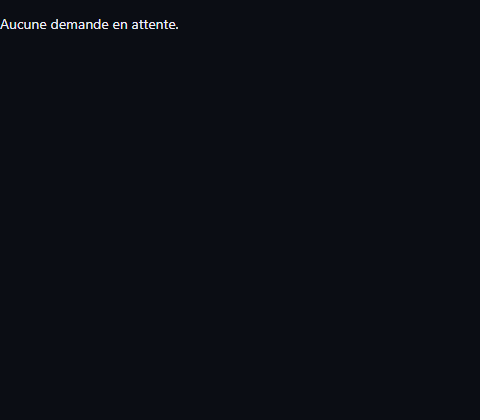
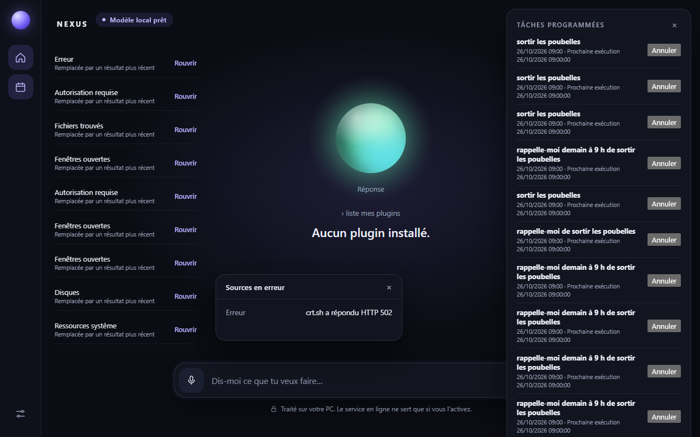

# NEXUS

[](https://github.com/florentvdry/nexus/actions/workflows/ci.yml)
[](LICENSE)

**NEXUS** est un assistant personnel pour Windows, open source, inspiré des interfaces de type JARVIS.
Vous formulez une intention, NEXUS choisit les outils. Les demandes sont comprises par un modèle de langage qui tourne
sur votre PC (Ollama). Sans compte et sans abonnement. Un service en ligne n'est utilisé que si vous l'activez.

> **Statut** : application utilisable sur Windows. Les tests de bout en bout ont tourné sur l'application réelle, sur
> ce poste (résultats plus bas). Ce qui reste à faire, et ce qui n'est pas vérifié, est listé dans
> [docs/TODO.md](docs/TODO.md). Pas encore d'installateur public.

## Ce que fait NEXUS

| Domaine | Exemples de demandes | Remarques |
| --- | --- | --- |
| Applications | « Lance le Bloc-notes », « Ouvre Discord », « Open Google Chrome » | Toute application trouvée sur ce PC par son nom (menu Démarrer, registre, dossiers des programmes). |
| Système | « Affiche les informations de mon ordinateur », « Affiche l'utilisation CPU » | Processeur, mémoire, disques, durée de fonctionnement, réels. |
| Alertes | Automatiques | Disque presque plein, mémoire saturée, batterie faible non branchée. Une alerte par événement. |
| Fenêtres | « Liste mes fenêtres », « passe sur la fenêtre Word », « ferme la fenêtre Discord » | Windows uniquement. Chaque action demande votre accord. |
| Contrôles de la fenêtre active | « Qu'est-ce qu'il y a dans cette fenêtre ? », « clique sur le bouton Enregistrer » | Lit les boutons et champs de la fenêtre au premier plan, hors NEXUS ; les mots de passe ne sont jamais lus. Activer un bouton demande votre accord, et seulement si son nom est unique. |
| Fichiers | « Cherche mes PDF téléchargés cette semaine », « Renomme a.pdf en b.pdf », « Annule la dernière action » | Recherche dans Documents, Téléchargements, Bureau et Images. Renommer, déplacer, copier et supprimer demandent votre accord ; la suppression passe par la corbeille, et la dernière action peut être annulée. |
| Visionneuse | « Affiche le fichier notes.md » | PDF, image, texte, Markdown, CSV, audio et vidéo, en lecture seule. |
| Processus | « Quelles applications sont ouvertes ? » | Lecture seule, triée par mémoire utilisée. |
| Agenda et messages | « Qu'est-ce que j'ai aujourd'hui ? », « écris à Alice que je suis en retard » | L'agenda se lit depuis un fichier .ics que vous désignez, en lecture seule. Un message n'est qu'un brouillon à copier : NEXUS n'envoie rien. |
| Écran | « Qu'est-ce qui est affiché à l'écran ? » | Une seule capture, après votre « oui », lue par un modèle de vision local. Rien n'est enregistré sur le disque. |
| Questions et actualités | « Qui est Ada Lovelace ? », « Montre une photo de la tour Eiffel », « Quelles sont les actus ? » | Sources publiques : recherche web sans clé, Wikipédia, Wikimedia Commons, Google Actualités. Les sources officielles passent avant les sites commerciaux, qui sont signalés. |
| Tâches programmées | « Rappelle-moi demain à 9 h », « Chaque lundi, résume mes actus » | Exécutées pendant que NEXUS est ouvert. Liste et annulation dans le panneau Planning. |
| OSINT | « Analyse example.com », « Recherche le pseudo alice », « Analyse le fichier C:\\Users\\Ana\\contrat.pdf » | Sources publiques. Chaque résultat indique sa source, sa référence et son statut. Une correspondance n'est pas une identité. |
| Claude Code | « Lance Claude Code dans C:\\Dev\\projet : corrige le test en échec » | Lance le CLI officiel `claude` dans ce dossier, après votre accord. Le CLI doit être installé et connecté. |
| Connecteurs | « Envoie un message Discord » | Serveurs MCP du registre officiel, seulement s'ils ont au moins 50 étoiles sur GitHub, installés après votre accord. Vous réglez ensuite l'écriture et la suppression. Node.js est requis. |
| Plugins | « installe le plugin <dossier ou adresse HTTPS> », « liste mes plugins » | Plugins de données (vocabulaire, sans code) et plugins WebAssembly (bac à sable). Chaque installation demande deux confirmations. |

Les commandes se formulent en français ou en anglais, et NEXUS retient ce dont on parle : après « cherche mes fichiers txt »,
« renomme le deuxième en idees.txt » fonctionne. Quand une demande est ambiguë, NEXUS demande lequel. Une action
destructive passe toujours par une confirmation, y compris après une référence.

## Modèle de langage local

- Chaque demande est comprise par un modèle qui tourne sur ce PC, via Ollama (adresse `127.0.0.1` seulement).
  Au premier lancement, NEXUS propose d'installer Ollama et un modèle, après votre accord. Le modèle dépend de la machine
  (Qwen2.5 1,5 B, 7 B ou 14 B) et reste modifiable dans les réglages.
- Sa réponse est contrainte par un schéma et validée avant usage. Elle n'est jamais exécutée telle quelle.
- Sans modèle prêt, NEXUS le signale et ne devine rien.
- **Mesures** sur ce poste (RTX 4060 8 Go, 129 demandes FR/EN, corpus dans `src/core/language-model/corpus.json`) :

  | Modèle | Justes | Moyenne par demande | Choisi automatiquement ici |
  | --- | --- | --- | --- |
  | qwen2.5:14b | 99,2 % | 4,6 s | non : trop lent pour la limite de 3 s |
  | qwen2.5:7b | 96,9 % | 0,5 s | oui |
  | qwen2.5:1.5b | 86,8 % | 0,7 s | non |

  Le 14 B n'est pas proposé sur une carte de 8 Go : il déborderait dans la mémoire vive (ADR-045).
- **NVIDIA NIM (option, désactivé par défaut)** : avec votre clé, les demandes sont envoyées à NVIDIA, avec seulement les
  catégories que vous cochez. Sans clé, ou en cas d'échec, le modèle local répond.
- **Mémoire** : le modèle retient les informations durables que vous donnez (prénom, préférences). « Oublie X » les efface,
  et la liste se consulte dans les réglages. Pour chaque demande, il ne reçoit que les souvenirs qui s'y rapportent, et
  les plus récents, au plus douze (ADR-046). La conversation elle-même n'est pas conservée au redémarrage.

## Autorisations, annulation et journal

Pour les actions répétitives, la case **« Toujours autoriser »** de la carte de confirmation évite de répondre à chaque fois :

- écriture de fichiers dans un dossier donné (sous-dossiers compris) ;
- lancement de Claude Code pour un projet donné.

Elle n'est jamais proposée pour la suppression, la fermeture de fenêtre, l'activation de bouton ni les plugins. Chaque
approbation automatique est annoncée dans la conversation, journalisée, et chaque règle se révoque dans les réglages.

- **Annuler la dernière action** : renommage, déplacement, copie et corbeille peuvent être défaits. Une seule action est
  gardée, et l'annulation passe par la même confirmation (ADR-047).
- **Journal d'audit** : chaque demande sur les fichiers laisse une ligne avec une empreinte, sans chemin ni contenu.
- Détails dans [docs/PERMISSIONS.md](docs/PERMISSIONS.md).

## Voix

- Clic sur le bouton micro, ou raccourci global `Ctrl+Alt+Espace` (il peut déjà être pris par une autre application). La saisie texte reste disponible.
- Reconnaissance hors ligne avec whisper.cpp et Silero VAD : aucun audio n'est envoyé à un service externe.
- Lecture à voix haute avec Kokoro, une synthèse neuronale locale. Reconnaissance avec Whisper. La voix française et la
  reconnaissance s'installent depuis les réglages vocaux, sur votre clic, en une fois (environ 390 Mo). Sans elles, la voix
  installée sur Windows lit la réponse.
- Langue automatique, ou français ou anglais imposé.
- Pas de mot de réveil : l'écoute ne s'ouvre que sur votre action.

**Modèles** : rien n'est inclus dans NEXUS. Le clic sur « Installer » télécharge depuis les dépôts officiels (GitHub, Hugging Face), vérifie chaque fichier par sa somme SHA-256, puis range les fichiers dans `%APPDATA%\fr.nexus.assistant\`. Les versions utilisées sont décrites dans [ADR-058](docs/DECISIONS.md).

## Thème

« Suivre Windows » par défaut : clair ou sombre selon le réglage de Windows. Le choix se fait dans l'accessibilité, avec la
taille du texte (ADR-048).

## Plugins

- **Plugins de données** : « installe le plugin … » examine le plugin, puis l'installe après deux confirmations. Un plugin
  de données ajoute du vocabulaire et des noms d'applications ; il ne contient aucun code.
  Spécification : [docs/PLUGIN-SPEC.md](docs/PLUGIN-SPEC.md). Exemple : `examples/plugins/community.exemple.verbes`.
- **Plugins WebAssembly** : écrits en Rust (SDK `sdk/nexus-plugin-sdk`), ils ne s'exécutent que dans un bac à sable. Ils ne
  reçoivent que le stockage et le réseau déclarés dans leur manifeste, approuvés à l'installation.
  Exemple : `examples/plugins/community.exemple.convertisseur` (« convertis 12 km en miles », « retiens … », « rappelle »).
- Les plugins livrés, et leurs permissions : [docs/PLUGINS.md](docs/PLUGINS.md).

## Journal des commandes

Désactivé par défaut. Activé dans les réglages, il garde le texte de vos commandes (500 au plus), jamais les résultats ni le
contenu des fichiers. Effaçable à tout moment. Voir [docs/PERMISSIONS.md](docs/PERMISSIONS.md) pour le détail.

## Installation

NEXUS n'a pas encore d'installateur public. Pour le lancer depuis le code source, suivez le guide de développement :
[CONTRIBUTING.md](CONTRIBUTING.md#mise-en-place).

En résumé : Node.js 22, pnpm 10, Rust 1.97 ou plus récent, et sous Windows les Outils de build Visual Studio (charge C++)
et WebView2 (présent sur Windows 11).

```bash
pnpm install
pnpm tauri dev
```

Au premier lancement, NEXUS installe Ollama et le modèle de langage après votre accord. Le téléchargement peut peser
plusieurs Go.

## Tests

Les vérifications automatiques et le parcours de bout en bout sont décrits dans [docs/TESTING.md](docs/TESTING.md).

- `pnpm typecheck`, `pnpm test` (TypeScript, Vitest) et `cargo test --lib`, `cargo clippy --all-targets -- -D warnings`
  (Rust) passent sur ce poste.
- Les tests marqués `ignored` touchent le vrai bureau ou le vrai modèle : corpus de compréhension
  (`NEXUS_BENCH_MODEL=qwen2.5:7b cargo test comprehension_bench -- --ignored --nocapture`), corbeille, contrôles de
  fenêtre. Leur liste est dans [docs/TESTING.md](docs/TESTING.md).

### Tests de bout en bout

Dernier passage complet sur ce poste, avec l'application de bureau réelle et le modèle `qwen2.5:7b` : **42 vérifications sur 44 réussies**. Les parcours couvrent le premier lancement, la conversation, les informations système, les fenêtres, les fichiers, l'agenda, la mémoire, la planification, le web, la lecture d'écran, l'OSINT, les connecteurs, les plugins et les réglages.

Les deux vérifications en échec, la conversion par plugin et le renommage de fichier, ont été corrigées depuis, sans nouveau passage complet. La conversion déduit maintenant la commande des déclencheurs que le plugin déclare, quand le modèle l'omet. Le renommage échouait par intermittence ; une relecture de la demande a produit la confirmation attendue, mais il n'a pas été relancé de bout en bout.

Le détail de chaque vérification est dans `e2e/results.json` ; les captures sont dans [docs/screenshots/](docs/screenshots/).





## Confidentialité

- Les demandes sont comprises par le modèle local, sur ce PC. Elles ne partent vers NVIDIA que si vous activez l'option NIM
  et fournissez une clé.
- Les questions ouvertes et les actualités interrogent des sources publiques (recherche web sans clé, Wikipédia,
  Wikimedia Commons, Google Actualités) : seuls les termes de la recherche sont envoyés, et jusqu'à trois pages de
  résultats sont lues, sans compte.
- Les recherches OSINT interrogent les sources publiques que leur résultat cite.
- Aucune capture d'écran sans votre « oui », et aucune capture n'est enregistrée.
- Les contrôles de fenêtre ne lisent ni les mots de passe ni les valeurs des champs.
- Les voix sont téléchargées une seule fois, après votre accord. La lecture se fait sur ce PC.
- Aucun micro n'est utilisé sans que vous l'activiez.
- Le démarrage avec Windows est une case des réglages. Rien n'est écrit à l'installation.
- Aucune élévation de privilèges n'est demandée.
- Le détail de ce qui est confirmé, et de ce qui ne l'est pas : [docs/PERMISSIONS.md](docs/PERMISSIONS.md).

## Documentation

- [docs/TODO.md](docs/TODO.md) : ce qui reste à faire, et ce qui n'est pas vérifié. Seul document de suivi.
- [docs/ARCHITECTURE.md](docs/ARCHITECTURE.md) : structure du code et flux de données.
- [docs/PERMISSIONS.md](docs/PERMISSIONS.md) : permissions, confirmations, autorisations mémorisées, journal d'audit.
- [docs/DECISIONS.md](docs/DECISIONS.md) : décisions d'architecture (ADR). Une décision remplacée le dit en tête.
- [docs/TESTING.md](docs/TESTING.md) : tests automatiques et parcours de bout en bout sur l'application réelle.
- [docs/PLUGINS.md](docs/PLUGINS.md) et [docs/PLUGIN-SPEC.md](docs/PLUGIN-SPEC.md) : plugins et paquets de données.

## Contribuer

Voir [CONTRIBUTING.md](CONTRIBUTING.md). Signaler une vulnérabilité : voir [SECURITY.md](SECURITY.md).

## Licence

MIT. Voir [LICENSE](LICENSE).
